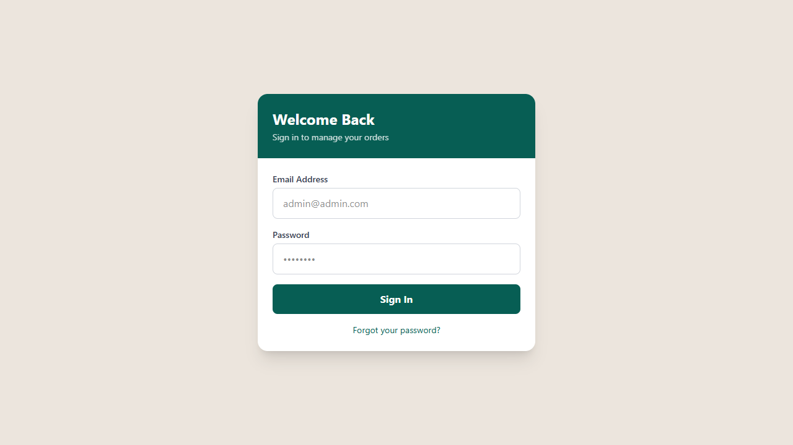

<p align="center"></p>

# KapdaFactory

KapdaFactory is an admin-facing order-management application. Its current implementation concerns customer records, tailoring orders, collection/payment information, and delivery operations. Next.js routes sit above server-side domain helpers and a PostgreSQL model managed through Prisma. The repository contains validators, unit checks, and browser-test material. It is not accurately described as a general public fashion marketplace: the management workflow and administrator setup are the important entry points for this codebase.

[](https://github.com/ak1458/kapdafactory-web-nextjs/stargazers)
[](https://github.com/ak1458/kapdafactory-web-nextjs/watchers)
[](https://github.com/ak1458/kapdafactory-web-nextjs/forks)
[](https://github.com/ak1458/kapdafactory-web-nextjs/activity)
[](LICENSE)

**[How it works](#how-it-works) · [Run locally](#run-locally) · [Configuration](#configuration) · [Commands](#development-commands) · [Versions](#versions-and-distribution) · [License](#license)**

## Interface preview

The following images are existing repository captures; they are not a new acceptance run.




## How it works

1. Configure the development database and authentication secret, then provision administrator access for that environment.
2. Create or open a customer/order record and work through its order detail and delivery-related screens.
3. Record the permitted payment/collection changes through server routes rather than bypassing domain validation.
4. Review operational views and exports; validate authenticated access and mutation behavior before a public deployment.

## Architecture

| Path | Purpose |
| --- | --- |
| [src/app/](<src/app/>) | Page routes and API endpoints. |
| [src/server/](<src/server/>) | Order access, serializers, Prisma, validators, dates, and CSV helpers. |
| [src/components/](<src/components/>) | Reusable interface components. |
| [prisma/schema.prisma](<prisma/schema.prisma>) | Relational model. |
| [e2e/](<e2e/>) | Playwright flows and checked-in captures. |
| [scripts/](<scripts/>) | Local development utilities. |

## What is here

- Order and delivery management screens with supporting API routes.
- PostgreSQL models through Prisma and server-side order helpers.
- Session authentication, input validators, and image-storage integration.
- Unit and Playwright test scripts.

## Run locally

```bash
git clone https://github.com/ak1458/kapdafactory-web-nextjs.git
cd kapdafactory-web-nextjs
npm ci
cp .env.example .env.local
```

Configure a **development** database and `AUTH_SECRET`, then apply the schema and start the app:

```bash
npm run db:push
npm run dev
```

Review the [environment template](.env.example). Blob storage and password-reset email need their own credentials. Configure administrator access for the target environment before exposing the app.

## Engineering notes

`src/app/` contains routes, `src/server/` contains domain and database helpers, and `prisma/` defines the data model.

Available checks: `npm run lint`, `npm run typecheck`, `npm test`, `npm run test:e2e`, and `npm run build`. `npm run vercel-build` generates the Prisma client and builds the app; it does not apply database migrations.


## Configuration

Settings template: [.env.example](<.env.example>). Copy it to the application’s local environment file and fill only the integrations you use.

| Variable | Purpose |
| --- | --- |
| `DATABASE_URL` | Database connection used by the server or ORM. |
| `NEXT_PUBLIC_SUPABASE_URL` | Supabase project endpoint; use the intended development project. |
| `NEXT_PUBLIC_SUPABASE_ANON_KEY` | Publishable client key; access still depends on authentication and database policies. |
| `NEXT_PUBLIC_SUPABASE_PUBLISHABLE_KEY` | Publishable client key; access still depends on authentication and database policies. |
| `AUTH_SECRET` | Server-side session signing secret. |

Environment files and provider tokens must remain untracked. A public client prefix exposes a value in the browser bundle; it is not a safe place for privileged credentials.

## Development commands

Workspace: [package.json](<package.json>). Run these commands from its directory.

| Command | Script defined in manifest |
| --- | --- |
| `npm run dev` | `node scripts/dev-server.mjs` |
| `npm run build` | `next build` |
| `npm run vercel-build` | `prisma generate && next build` |
| `npm run start` | `next start` |
| `npm run lint` | `eslint` |
| `npm run typecheck` | `tsc --noEmit` |
| `npm run test` | `jest` |
| `npm run test:watch` | `jest --watch` |
| `npm run test:e2e` | `playwright test` |
| `npm run test:e2e:ui` | `playwright test --ui` |
| `npm run test:e2e:headed` | `playwright test --headed` |
| `npm run check` | `npm run lint && npm run typecheck && npm run build` |
| `npm run db:push` | `prisma db push` |
| `npm run db:generate` | `prisma generate` |
| `npm run db:studio` | `prisma studio` |

These are available commands, not a claim that all checks passed in this documentation pass. Connected checks require the services, credentials, and isolated data described above.

## Operational notes

The root manifest requires Node.js 20 or later. npm run db:push changes the target schema, so use a disposable development database for setup. npm run vercel-build runs Prisma generation and the application build; it does not apply a database migration. The screenshots below are existing repository captures, not a fresh acceptance test. Review the QA documents for their dates and known failures before treating them as current proof.

## Troubleshooting

| Symptom | What to check |
| --- | --- |
| The login flow does not accept an account | Provision the correct administrator and verify the authentication configuration; avoid deploying sample credentials. |
| Images cannot be stored | Check the server-side Blob configuration and whether the route expects that integration. |
| The deployment builds but data routes fail | Confirm the production database schema and connection independently; generating a Prisma client is not a migration. |

## Versions and distribution

Manifest versions are application/workspace metadata, not a certification of release readiness.

| Manifest | Declared version |
| --- | --- |
| [package.json](<package.json>) | `1.0.0` |

The repository has source tags (`v2.0.0`, `v2.0-deployed`), but no published GitHub Release was recorded in this snapshot. [Browse tags](https://github.com/ak1458/kapdafactory-web-nextjs/tags). Tags and release notes are separate objects. The `v2.0.0` tag points to an older Laravel tree rather than this Next.js application, and its tree includes a tracked `.env` file. It is not promoted here as a current installable release; review that historical configuration separately before distribution.

GitHub Packages is a separate registry. This README does not imply that a registry package exists; use the installation path documented here rather than an invented package-install command.

## Documentation and maintenance

- [TESTING_CHECKLIST.md](<TESTING_CHECKLIST.md>)
- [QA_REPORT.md](<QA_REPORT.md>)
- [E2E_TEST_REPORT.md](<E2E_TEST_REPORT.md>)
- [SECURITY.md](<SECURITY.md>)

For change proposals, see [CONTRIBUTING.md](CONTRIBUTING.md). Include the affected workflow, reproduction steps, and relevant check output when reporting a problem. Do not include credentials or live customer data.

## License

This repository’s project code is **proprietary / all rights reserved**. Public visibility does not grant unrestricted reuse. Read [LICENSE](<LICENSE>) for the exact terms. Third-party dependencies and bundled components retain their own notices.
